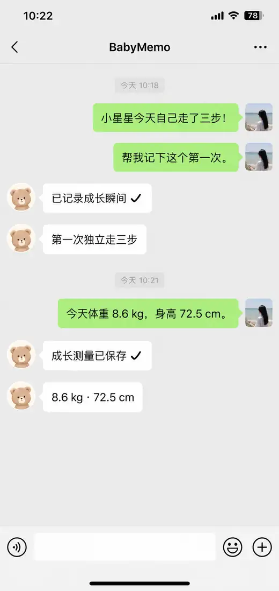
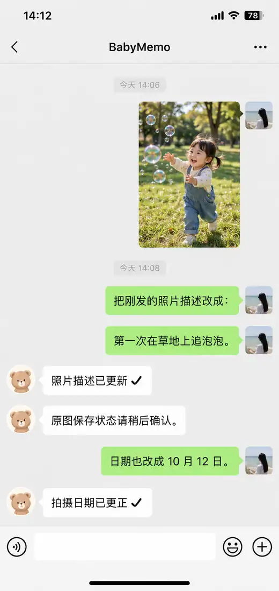

# BabyMemo

> 一家人的成长，都记在这里。

## 在线体验

直接打开已部署的 BabyMemo，无需查看模拟界面截图：

**[体验网页 Demo](https://babymemo.zhajiahe1994.workers.dev/demo)** · **[体验移动端 Demo](https://babymemo.zhajiahe1994.workers.dev/demo/mobile)**

两种演示均使用虚构家庭和示例记录，**无需登录、只读、不访问真实家庭数据**。可浏览照片故事、切换相册视图和查看成长曲线。移动端入口在电脑上提供可交互的手机画面，在手机上直接展示移动界面。

## 微信里，直接记录和管理

发消息就能操作 BabyMemo：记录成长瞬间、发送照片或视频、补充照片故事、查询历史和更正记录。无需为了每次记录都打开网页。

| 一句话记下成长 | 发照片，补写故事 |
| :---: | :---: |
|  |  |
| **随时查询历史记录** | **找到记录后直接更正** |
|  |  |

<sub>以上均为 AI 生成的仿微信界面模拟图，非真实微信聊天截图；演示数据与头像均为虚构，不代表每条指令必定成功。只有实际保存成功才会确认写入；照片原图可能仍在上传，目标不明确的修改会要求先确认。微信功能需要完成绑定和部署。</sub>

私密的家庭成长记录应用。家人可以在网页或微信中记录宝宝的照片、视频、成长数据与生活瞬间。

## 功能

- **家庭空间**：管理多个宝宝，记录和相册按宝宝分别保存。
- **照片与视频**：按日期浏览、阅读照片背后的故事、编辑与恢复记录。
- **成长记录**：查看成长曲线、测量历史与成长瞬间。
- **微信记录**：通过自然语言查询和整理记录，也可以发送照片、视频；通过微信「文件」发送支持的照片/视频原文件以保留其自带的拍摄日期（每项不超过 50 MiB）。
- **离线与导出**：暂存离线操作，恢复网络后同步；下载完整家庭档案。

[](https://deploy.workers.cloudflare.com/?url=https://github.com/zhajiahe/babymemo)

## 安装与使用

按 [部署指南](docs/DEPLOY.md) 安装，在 HTTPS 首页创建家庭管理员和首位宝宝。空实例应先初始化或限制公开访问。

[网页、离线与导出](docs/web-management-offline.md) · [备份与恢复](docs/BACKUP.md)

## 开发与维护

本项目运行于 Cloudflare Workers + D1 + 私有 R2 + Durable Objects，前端采用 React + TypeScript。开发环境需要 Node.js 22+：

```sh
npm install --no-audit --no-fund
npm run db:local
npm run dev
# 另一终端：npx wrangler dev --local
npm run verify
npm run test:e2e
```

维护者入口：[工程规范](ENGINEERING.md) · [Agent 约束](AGENTS.md) · [设计规范](docs/design-system.md) · [Actions 部署](docs/github-action-deploy.md) · [Agent Runbook](docs/agent-deploy.md) · [测试与 CI](docs/qa-regression-matrix.md)。

**数据安全**：保护 `SESSION_SECRET` 和 `DATA_KEY`，不要将真实照片、家庭资料或凭据放入测试、日志、GitHub Issue 或 PR。许可见 [LICENSE](LICENSE)。
