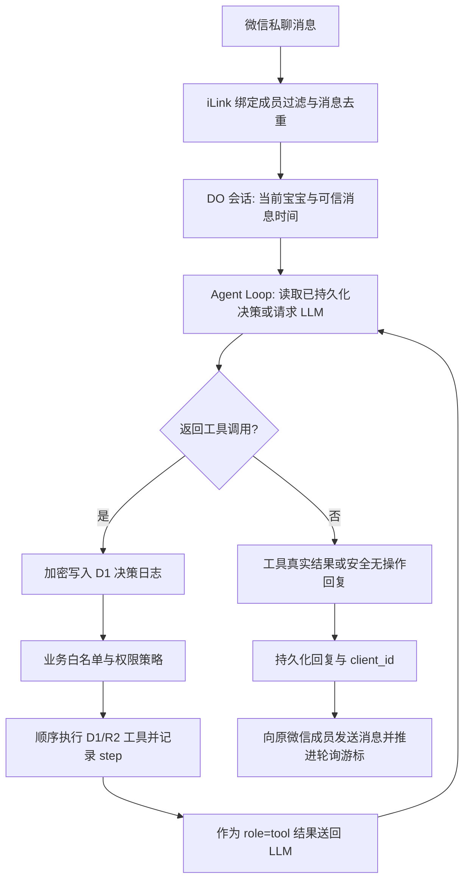

# BabyMemo 微信 Harness：ReAct 架构与实施边界

> 本文描述 `feat/wechat-react-loop` PR 中的代码设计与待验证项目。**合并且生产部署前不代表已上线。** 历史场景见 [场景审查](wechat-harness-review.md)，可执行证据见 [测试计划](wechat-harness-test-plan.md) 和 [QA 矩阵](qa-regression-matrix.md)。

## 一、架构决策（ADR-001，2026-10-13）

**决定**：继续使用 Cloudflare Workers + iLink Durable Object + D1/R2 + OpenRouter，并在应用内加入小型、多轮、有界的 ReAct 调度层。暂不引入 `pi-agent-core` 运行时依赖，也不引入规范化自然语言解析器、独立 VPS、通用聊天或代码执行工具。

原因：

1. 现有微信通道已经实现账号独立轮询、受信任的消息归属、D1 消息去重、媒体重试、审计、条件撤销和 20 分钟短期上下文。迁入另一种 Agent 运行时将改变这些生产边界。
2. `pi-agent-core` 的核心价值是模型调用、工具观察反馈、事件/状态和回合循环。BabyMemo 现阶段需要的是**有限的请求内闭环**，可用不到百行的独立核心实现。
3. Cloudflare 官方已提供基于 Pi Durable 的 `PiHarness` 集成，但截至 2026-10-13 仍处于 Beta；其持久会话方案涉及 `agents`、`@earendil-works/pi-durable`、SQLite-backed DO 及生命周期的运维决策，不应在没有真实兼容性测试的情况下替换现有消息处理。
4. OpenRouter 当前默认模型需要实际验证多轮 `tool_call_id`、`role:tool` 的契约与延迟；不能仅凭本地 Mock 声称线上模型具备完整能力。

### 框架选型比较

| 方案 | 当前的优势 | 当前不足/迁移成本 | 本轮结论 |
| --- | --- | --- | --- |
| 现有 OpenRouter + 独立 ReAct 核心 | 完全复用 D1/DO/iLink、已测的本地协议；模型仍可在网页配置 | 需要维护有界循环、日志与工具契约；不支持复杂的中断续跑 | **选择** |
| [pi-agent-core](https://www.npmjs.com/package/@mariozechner/pi-agent-core) | 已有成熟模型/工具事件循环和自定义流适配 | 需要验证适配当前 OpenRouter REST/provider、Worker 打包、预算与存储接口 | 候选 PoC |
| [Cloudflare Pi Harness](https://developers.cloudflare.com/agents/harnesses/pi/) + Pi Durable | DO SQLite 持久事件和崩溃唤醒、长时会话运行时 | 当前 Beta，涉及 agents + Pi Durable 生命周期迁移；不是只增加一个 npm 依赖 | 长任务阶段评估 |

框架以**生产必要性**而非 feature 数量决策。PoC 必须用同一份离线 R 系列安全测试和至少 20 条人工合成真实模型样本对照，一次完成率、误写次数、p95 延迟、工具调用次数、冷启动与每请求成本都有数据之后才考虑切换。仓库不引入未验证的实验性运行时。

**时间工具输出边界**：`get_runtime_context` 的 JSON 是 ReAct 内部 Observation，仍完整传递给下一轮模型，但绝不直接拼入微信最终回复。若只读取时间，则使用模型对可信时间的自然语言答复；如与其他写工具共同调用，只展示实际写入结果或失败原因。模型无工具时可以自然回复，但不能虚构保存成功。明确「记下来」且历史用户原话包含「昨晚/昨天」时，系统提示提供经服务端校验的日期，减少重复工具调用。老版本已持久化的微信回复不能被追溯撤回。

**重新评估 pi-agent-core 的触发条件**：需要队列内后台长任务、跨重启续跑、steering/follow-up、流式事件或复杂工具插件生态时，专门做对照 PoC。要求证明 Cloudflare Worker/DO 兼容、OpenRouter 动态模型可选、不会破坏用户数据迁移、双账号隔离、幂等与成本预算。不能只比较 Demo。

## 二、端到端控制流

- **模型**：只决定下一步工具和结构化参数，不获得 SQL、任意 URL、Shell、R2 key、Cloudflare 管理权限或未授权家庭数据。
- **工具**：`src/wechat-harness.mjs` 是能力白名单和数据库事实来源。新增 `get_runtime_context` 返回可信的发送时间、日期、时区和当前宝宝；普通指令的当天日期仍直接放在系统上下文，避免额外模型回合。
- **循环**：`src/wechat-agent-loop.mjs` 单轮最多 4 个工具，总计最多 8 个工具、4 次模型决策、90 秒软上限。单轮工具顺序执行；每次调用结果都附上 `role: tool` 和原 `tool_call_id`，模型再决定继续或结束。
- **安全与执行**：`src/wechat-orchestrator.mjs` 执行每项独立调用、做原文/身份/值域/目标校验、审计和记录去重。拒绝或失败的写操作终止剩余链；只读结果可供下一回合。
- **自然回复**：首轮未调用工具时保留模型的正常澄清、承接和询问；无工具回复中不允许虚构已保存/已修改/已删除。用户明确说“记下来”时，取当前宝宝近三条用户观察作为 **仅限 `create_milestone`** 的可信日期/事实依据，忽略助手回复；日记和里程碑仍使用同一张记录表，不增加日记 schema。绝不因观察性描述自动写库。另用隔离微信 Worker E2E 验证四条真实消息后只保存一条日记。
- **输出**：只有工具返回的真实数据才可被当成“已保存/已更新”的依据。发生部分成功，回复必须列出已提交步骤；不得用 LLM 自由文本覆盖工具返回的事实。当前版本主要直接拼接工具实际返回，尚未完成结构化最终摘要。
- **会话**：Durable Object 按微信连接隔离，最多 4 条历史对话、20 分钟 TTL；模型不拥有跨账号的可复用 recordId。

### 同一条指令中的先查后改

用户「把宝宝昨天的体重改为 10.2kg」：

1. 模型执行 `list_growth(day)`，服务端仅查询当前 babyId。
2. 工具返回唯一记录编号；`recordQuery` 将 ID、类型、babyId 和**来源消息 ID**存入 DO 短期状态。
3. 下一回合模型执行 `update_growth(id,weight)`；只有 `recordId` 来自**当前消息的可信查询结果**或上一轮经服务端明确解析的引用，才允许引用。单纯由 LLM 发明的 ID 不授予权限。
4. D1 更新按目标记录验证并返回真实结果，模型可终止。目标多个或查不到时必须澄清，不能猜测。

## 三、请求重放与恢复顺序

`migrations/0015_wechat_agent_rounds.sql` **仅新增** `wechat_agent_rounds(message_id,round_index,assistant_cipher,created_at)`：

- 第 n 轮先查是否有已加密保存的模型决策；若存在，重放完全相同的 `tool_calls`，**不重新询问模型**。
- 若不存在，先获取模型结果，校验工具调用结构，再以 `DATA_KEY` 加密并写入 D1，随后才执行任何副作用。
- 每条工具调用采用稳定键 `message_id:step:<global_step_index>`，继续复用 `wechat_tool_steps`、`wechat_operation_log`、业务源消息 ID 去重及 D1 操作审计。
- 写工具被拒绝、调用上限或模型后续失败时，必须保留已经成功的执行结果；不存在跨 D1/R2 的全局回滚。
- 当前写前决策日志保证**重放选择确定性**，但尚不等于任意宕机位置的 exactly-once 事务。所有写操作仍须自身具备 D1/R2 幂等保障；涉及并发操作的实际一致性需要继续验证。
- 生产日志不得记录 `assistant_cipher` 的明文、家庭真实指令、密钥、图片 URL。正常运维只记录错误代码、耗时和计数。

### 失败矩阵

| 故障时点 | 期望行为 |
| --- | --- |
| 模型未返回工具 | 不写库；提示改写或明确补充 |
| 模型返回无效调用 | 拒绝执行，不猜造参数 |
| 决策日志写入失败 | **零工具副作用**；保留原消息等待重试 |
| 模型决策已保存、执行前中断 | 再次请求复用模型决策，按原步骤重试 |
| 工具写入完成但 step 日志丢失 | 依赖业务 source_message_id / 审计条件重新读取和拒绝重复 |
| 中间已写入、后续模型限流 | 仅报告已执行部分，提示后续未执行 |
| 回复发送失败 | 原消息的结果、client_id 和微信游标按既有机制恢复 |
| 目标缺失/歧义/跨宝宝 | 零越权写入；要求澄清 |
| 预算耗尽 | 立即停止未开始的新步骤；已提交结果不回滚 |

## 四、关于“自然语言理解和安全校验”的责任划分

不另造一套中文日期 NLP 解析器：复杂语义、用户意图、任务拆解、查询策略由 LLM 负责。但**风险校验仍属于程序**：

- 生效的角色、宝宝归属、唯一记录 ID、日期合法性、单位与范围、否定及条件写入不可让模型绕过。
- `10.1号` 属于简单但缺失的词法表达，补充一个局部兼容回归即可；不把自然语言日期转换再造为完整 Agent 前置条件。
- `大概 13.7kg` 不应改变成“实测 13.7kg”。在当前没有独立测量精度列的 schema 中，模型需把估计含义记入 notes，测试检查值和备注。
- “国庆节”“上上周”“10/1”等超出当前校验可解释边界的表达，还需明确采用证据片段 + 歧义判断策略；**不得仅为提高一次完成率取消误写护栏**。

## 五、代码与测试落点

| 文件 | 作用 |
| --- | --- |
| `src/wechat.ts` | 微信收发、账号过滤、消息/会话路由、Agent 调用和加密决策日志适配 |
| `src/wechat-agent-loop.mjs` | 完全独立的 LLM→Tool→Observation 循环与成本/执行预算 |
| `src/wechat-harness.mjs` | 工具声明、受控查询/写入、runtime context |
| `src/wechat-orchestrator.mjs` | 按步骤执行、查询凭证、审计、拒绝策略和去重 |
| `src/wechat-memory.mjs` | 有 TTL 的微信会话、待补充任务、服务端可信查询结果 |
| `src/wechat-policy.mjs` | 日期/数值/目标保护；不负责完整自然语言规划 |
| `migrations/0015_wechat_agent_rounds.sql` | 模型决策的加密写前日志 |
| `scripts/wechat-agent-loop.test.mjs` | 多轮调用、观察结果、持久重放、预算、部分成功、异常 |
| `scripts/wechat-policy.test.mjs` | `10.1号` 等日期边界与阻断误写 |
| `scripts/wechat-worker-e2e.mjs` | 真本地 Worker/D1，合成模型两轮查询修改、实际字段保存 |

本地执行：`npm run verify`、`npm run test:e2e`。真实 OpenRouter 多轮工具协议只在管理员主动运行的手动工作流检查，不能混入自动 PR CI。

## 媒体任务、中文状态与原图拍摄日期

媒体接收与处理已分离：每个连接在现有 BOT namespace 中使用独立 Durable Object 消费加密持久任务，最多 32 条消息，每条仍最多两路媒体流。接收前固定宝宝；任务持久化后才回复已收到并推进轮询游标。媒体保存或重试不占用文字轮询，任务按接收顺序处理，结果回复使用持久凭证。暂停保留任务；重绑/移除清理旧任务，已经开始的原件保存可能完成，但不会执行旧附文或发布旧上下文。**文字和模型操作本身仍串行，不能保证所有文字请求的固定延迟上限。**

设置页每 10 秒刷新可见页面的中文运行状态；已启用不等于连接健康。区分未连接、正在连接、运行正常、媒体保存/重试、通知重试、部分保存失败、暂停与授权失效。状态不含媒体链接、AES Key、会话或模型原文。

附文工具仅在接收时的宝宝、会话代次及版本仍有效时执行；保存期间有后续消息或清除上下文时，照片仍保存，但会明确告知附文未执行，要求重新发送文字，避免旧操作覆盖后来的意图。

原图拍摄日期读取共用 src/media-date.mjs。微信从私有 R2 按需读取 EXIF（每次最多 256 KiB，总共最多 1 MiB、16 次），覆盖位于 HEIC 文件尾部的元数据；原文件字节不变，D1 索引重试沿用同一原件重新识别日期。微信压缩可能移除 EXIF，缺失时使用收到日期，不推测历史日期。视频日期策略保持原有行为。

新增自动化：DurableMediaQueue 的重启恢复、回复重试、并发入队、暂停/重绑与容量边界；Worker 中的慢媒体与文字交错、目标宝宝固定、JPEG/HEIC 日期与 D1 失败恢复；浏览器中真实 JPEG EXIF 上传、状态界面与 320/375/768/1280px 布局。Worker fixture 的 D1/R2 是真实本地绑定，iLink 和 DO 调度上下文是合成适配器，不构成真实微信或生产 DO 恢复验收。

## 六、后续任务（未实现）

1. **高优先级**：真实模型多轮 tool-calling 契约、延迟/费用评测；在评估集上看一次完成率和安全拒绝率，检查调用预算是否过小。
2. 引入可选用户确认状态，使多候选、模糊年份、可能冲突的批量写入有明确询问和确认流程；当前并非所有中文表达可一次完成。
3. 完善结构化 `ToolResult`（`ok/code/data/committedStepIds`）代替中文字符串成功检测；保留对旧版工具输出的兼容层。
4. 媒体持久任务队列已实现；后续补充真实微信、生产 DO 恢复及 iPhone 网络兼容验收。
5. 评估 pi-agent-core / Pi Durable 的官方 Cloudflare 集成在新能力上是否有可验证的工程净收益。

**合并门槛**：完整 4 项 CI、D1 增量迁移审查、线上部署和真实账号实验另行分开报告。测试通过并不等于已上线，也不等于真实微信多模型已实测。
