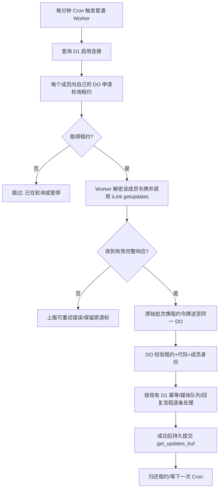

# ADR-002：微信 iLink 消息接收解耦及 DO 费用优化（研究方案，未实施）

> 状态：**Proposed / 待 PoC** · 2026-10-14。与 [PR #57 的短期方案](wechat-do-budget.md) 区分：本文是长期改造目标，不代表新架构已经部署。不得使用真实家庭消息、Token、密文或云端快照作为公开基准测试材料。

## 目标及不可妥协的边界

**目标：让普通 Cloudflare Worker 等待微信 iLink 的长轮询响应；Durable Object（DO）只负责连接级游标、单写者协调、顺序、会话和入站消息处理。** 保留 Workers + DO + D1 + R2、无 VPS、无需新的通用 Agent 基础设施。

- **成本目标（研发验收目标，不是承诺）**：两个启用微信成员、全天无消息时，DO 不发生等待 iLink 的外部 `fetch()`；观测 24–72 小时，DO `sum.duration` **低于 1,000 GB-s/天**，与同等使用量基线相比下降至少 85%。如果 Worker 端 CPU、D1、Queues 或其他开销升高，计算**所有账单维度总成本**而非只看 DO。
- **可靠性**：不丢、不跨成员、不重复提交日记/成长记录/媒体；任何异常中断后能从上次已确认游标恢复。保留已有 D1 去重、消息回复 `client_id` 和独立媒体队列。
- **用户体验**：候选 Cron 方案先设微信文本消息**送达处理 p95 < 60 秒**为试点门槛，明确它比当前连续长轮询慢；若用户需要更接近实时的响应（例如 p95 < 15 秒），再评估更高频的可靠调度方式及其配额。分别记录接收延迟和最终 AI 答复延迟，不把模型推理时长归咎于轮询。
- **兼容性**：两名以上微信成员、原有 `family`/新版连接、扫码/暂停/重连、多媒体与语音、引用/合并转发、OpenRouter 429 重试保持正常；DO ID、现有 D1/R2 数据和加密密钥不迁移。
- **运维**：允许开关/回滚；不得在旧 DO `alarm()` 和新调度器中同时轮询同一个 iLink 连接；不得把 CDN 解密参数、Access Token、原始家庭聊天输出到日志或 CI。

## 已证实的外部事实

1. **iLink 现有接收仍靠长轮询**。腾讯 [openclaw-weixin 协议](https://github.com/Tencent/openclaw-weixin/blob/main/docs/protocol_zh_CN.md) 的消息接收 API 是 `POST /ilink/bot/getupdates`，结果带 `get_updates_buf` 和可能的 `longpolling_timeout_ms`（例示 35,000 ms）。该文档列出 `notifyStart`/`notifyStop`，但它们是**客户端启动/停止通知**，不是 Bot 消息到我方的 Webhook。腾讯 [实际 monitor 代码](https://github.com/Tencent/openclaw-weixin/blob/main/src/monitor/monitor.ts) 使用循环长轮询并遵循服务器返回的建议超时。**未找到公开承诺的 Webhook 接口**，不等于证明未来永远不存在；如 API 改版应先重新评估。
2. **DO 等待外部 I/O 会产生运行时长**。Cloudflare [DO 生命周期](https://developers.cloudflare.com/durable-objects/concepts/durable-object-lifecycle/) 和 [2026-10-01 的 I/O 存活说明](https://developers.cloudflare.com/changelog/post/2026-10-01-pending-io-keep-alive/) 表明未完成的外部 `fetch` 会阻止 DO 休眠并保持计费。DO 免费配额 13,000 GB-s/天、100,000 次请求/天，128 MiB 的内存为计费基数，见 [定价](https://developers.cloudflare.com/durable-objects/platform/pricing/)。
3. **普通 Workers 侧网络等待不计入 CPU 时间**。见 [Workers 限额](https://developers.cloudflare.com/workers/platform/limits/) 和 [计费](https://developers.cloudflare.com/workers/platform/pricing/)；但免费计划每次 Worker 调用的 CPU 限制为 **10 ms**，不能把模型执行或大附件解密一起迁入轻量接收 Worker。Cron 和 Queue 消费者的单次**墙钟上限 15 分钟**，见 [平台调用限额](https://developers.cloudflare.com/workflows/reference/limits/)。
4. **Cloudflare Cron 最小实用周期是每分钟**：`* * * * *`，UTC 调度，存在触发时间偏移及配置传播延迟。见 [Cron Triggers](https://developers.cloudflare.com/workers/configuration/cron-triggers/)。
5. **Queues 是可选调度器，但免费额度并不宽裕**：支持 Worker 同时充当生产者/消费者及 `delaySeconds` 延迟。见 [Queues JavaScript API](https://developers.cloudflare.com/queues/configuration/javascript-apis/) 和 [批处理与重试](https://developers.cloudflare.com/queues/configuration/batching-retries/)；每个成功消息通常计写+读+删 **3 次操作**，免费计划**全账号共享 10,000 次操作/天**，见 [Queues 定价](https://developers.cloudflare.com/queues/platform/pricing/)。已有其他项目队列活动也会共用这一额度。

## 选型比较（优先级不是实施许可）

| 方案 | 延迟模型 | DO 成本 | 新增依赖 / 免费配额 | 风险与当前结论 |
| --- | --- | --- | --- | --- |
| A. 保持 DO 连续长轮询 | 收到新消息最快 | 持续较高 | 无 | 10/13 已接近 DO 免费配额，**不适合作为长期方案** |
| B. PR #57：DO 8s 监听 + 22s 休眠 | 估计增加数十秒级延迟，实际须测 | 有所下降但并未消除外部 I/O 计费 | 无 | 短期缓解；截断早于腾讯示例的 35s，**必须验证真实协议，未上线** |
| **C. 每分钟 Cron → 普通 Worker 长轮询 → DO 接收提交** | 轮询窗口 ~35s + 余下约 25s 空档，部分消息可能等近一分钟 | **空闲时 DO 可休眠** | 使用现有 Worker 的 `scheduled()`，无需新队列 | **首选 PoC**；响应延迟、Cron 抖动、租约和回滚待验证 |
| D. Queues 延迟任务 → Worker 长轮询 → DO | 可以设计更频繁的轮询，但队列延迟不是硬实时 SLA | 空闲时 DO 可休眠 | 2 成员×每分钟 1 次×3 操作≈**8,640 次/天**，仅余 1,360 次供重试及整个账号其他队列；30s 一次≈17,280 次/天，超过免费额度 | **备选**，必须先看账号整体 Queues 用量；不能仅为降低 DO 把瓶颈转移至 Queues |
| E. iLink 官方 Webhook/推送（若未来发布） | 理论上最佳 | 接近仅消息处理的用量 | 依赖未公开确认的新接口 | 仅作为协议跟踪事项，不按存在假设开发 |
| F. 长驻 VPS/外部 Bot 网关 | 低延迟、轮询灵活 | 低 | 新的服务器成本、运维和隐私风险 | 违反“Cloudflare 优先、无需 VPS”约束，**不选** |

**补充估算**：Cron 每分钟启动 1 个调度 Worker，一天约 1,440 次调度，两个成员约 2,880 次 iLink 调用/天。正常处理的 DO 请求/游标读写仍收费，但不再因**等待长轮询**持续计时。Cloudflare Worker 免费请求总额度为 100,000/天（并有 CPU 10ms/调用上限）；不能仅凭次数判断 CPU 和重试是否足够。单次 Cron 可以并发监听两个连接，但必须限定并发、对每个成员单独处理失败。以上是**设计容量估算，不是测试数据，也不代表保证每分钟准点执行**。

## 推荐方案 C：最小侵入的控制流

建议仅增加一条每分钟的 Cron 表达式，**保留项目原先每日 `0 19 * * *` 清理任务**；同一 Worker 内依据 `controller.cron` 分支执行两类作业，无需再配置第二个 Worker、额外 DO Namespace 或队列。只有研发评估证明其并发/资源隔离不足时才考虑单独 Worker。

**职责边界**

- *Worker 轮询器*：从 D1 读取本连接 `enabled`、加密凭据；通过 DO 内部方法获取单连接租约和**当前游标**；在 Worker 中解密凭据并向原 iLink 可信域名发起超时受控的 `getupdates`，把完整批次和租约回传 DO。Worker 不更新消息数据库、不推进游标、不对用户发送微信回复、不持有跨调用状态。
- *DO 会话*：仍是每个微信成员唯一的逻辑协调者。提供 `acquire/ingest/fail/release` 等内部接口；保存游标、租约代际与过期时间，接受批次时比较租约代际，顺序处理并复用现有 ReAct、D1 去重、`context_token`、媒体队列。**只有全部消息的持久处理/回复成功，才保存新游标**。
- *保护交付*：每批处理可能超过普通 Worker 请求的期望等待时长，因此要明确 DO `ingest` 接口是否先持久化消息后立即返回、再独立处理。不能用“收到即提交游标”替代真正的持久入队，也不能在未验证时让一次 Worker `fetch()` 持续等待整个 LLM 推理。
- *密钥*：只在原有 Worker/DO、加密 D1 和 Cloudflare Secrets 内使用；内网 DO 接口不可从公网调用；日志只保留匿名会话代号、结果类别、耗时和重试次数。不得把密钥写入 Queue 消息、Cron 参数或诊断状态。
- *故障模型*：重复 Cron / 消费者重试可能并发；DO **有租约过期+fencing token（代际）**，过期的 Worker 响应必须被拒绝，游标不能倒退。接收后 DO 死机则重播上一游标；既有 `wechat_messages`、`wechat_agent_rounds`、工具执行记录和 `client_id` 必须确保幂等。HTTP 401/403 禁用对应连接并保留其他成员；429/5xx 退避；取消及空响应不伪造成功。
- *一致性*：租约“已取得”与外部请求之间可能超时、取消或失联；应当在纯粹超时时保留游标并允许下一次 Cron 恢复。媒体下载/保存继续走独立 `wechat-media:<id>` DO，且在把消息确认为处理完毕之前持久入队。

> 注意：如果 D1/Cron 的结果被直接传给 DO 后，DO 仍连续调用 `getupdates`，或者 DO 把长轮询放入 `ctx.waitUntil()`，**并没有真正解决 DO 时长计费**。

## PoC 与分阶段实施清单

### P0：读协议与成本基线（不修改线上）

- 采用 **腾讯官方** [协议](https://github.com/Tencent/openclaw-weixin/blob/main/docs/protocol_zh_CN.md) 与 [monitor](https://github.com/Tencent/openclaw-weixin/blob/main/src/monitor/monitor.ts) 对照 BabyMemo `src/wechat.ts`，确认长轮询返回时序、`longpolling_timeout_ms`、空响应、取消/重试游标、成员暂停/重绑行为。重点验证 **8 秒客户端取消后，服务器不会出现持久丢消息**，否则不合并 PR #57。
- Cloudflare Analytics 按**UTC 日、命名空间+对象**记录 `durableObjectsPeriodicGroups.sum.duration`、`durableObjectsInvocationsAdaptiveGroups.sum.requests`、errors、相册入库延迟和微信接收/回答 p50/p95/p99；同时记录 Workers 请求数/CPU、Queues 操作数和 D1 读写。
- 仅使用虚构家庭和测试微信成员，不向模型或日志传送真实家庭媒体。保存可重放的合成 `getupdates` 响应样本，不保存生产 Token。

### P1：纯 Worker 轮询 PoC（独立 PR，默认关闭）

- 实现按成员限并发的 `scheduled()` 处理、内部 DO 单写租约、Token/游标管理、批次回传。
- 只对测试绑定成员灰度，生产其他微信连接继续原方案；启用灰度成员前，先停掉**该成员**旧 DO alarm，保证不会出现两个消费者抢同一游标。
- 本地 Worker E2E 覆盖：并发 Cron；DO 重启；租约过期、旧响应拒绝；重复/乱序批次；处理一半宕机；ACK 前/后断开；空响应；401/429/500；两位成员互不影响；微信文本/语音/视频/合并转发；队列持久化成功后才 ACK。
- 如免费 Workers CPU 10ms 上限导致 Worker 解密/解析不稳定，评估缩减 Worker 工作量或付费配额，不偷偷忽略这一限制。

### P2：真微信验收和发布

- 开通双微信测试连接，覆盖**连续空闲 10 分钟、恢复后第一次消息**、多消息突发、媒体 50MiB 及断网重试。比较同一天不同时间段的真实接收延迟。
- 发布采用显式特性开关，先一个非生产成员，之后另一成员；24–72 小时比较整体成本。所有切换都必须**原游标/原 DO ID**无损延续，不重建 D1/R2、不要求重新扫码。
- 失效或用量异常时先暂停新调度，等当前租约过期或明确释放，再恢复旧 DO alarm；不允许双消费者并发。

### P3：只有 P2 延迟不可接受才评估 Queues

- 首先核算**整个 Cloudflare 账号**现有 Queues 的实际操作数及峰值，并设预留额度；若预计总操作数超过 10,000/天（或接近上限无法留给重试），禁止在免费计划使用 30 秒或更高频率的自循环任务。
- 如采用同 Worker 既生产又消费的延迟消息，防止重投/多副本导致“双重下一条”，同样用 DO fencing；为长时间积压配置 DLQ、人工补偿和告警。
- 严格区分调度层成功与微信消息处理成功；Queue 的 at-least-once 语义不能替代消息的 D1 幂等。

## 决策门槛与资料索引

**先 PoC C，不直接迁移生产**。选型应按“**可靠收消息 > 不多写/不丢消息 > 时延 > 额度与成本**”排序。只要不能验证真实微信行为，就继续保留旧方案并排查费用；不能仅为节省计算时长随意放宽一致性保证。

主要一手资料：

- [腾讯 openclaw-weixin 协议（中文）](https://github.com/Tencent/openclaw-weixin/blob/main/docs/protocol_zh_CN.md)、[腾讯 iLink API 实现](https://github.com/Tencent/openclaw-weixin/blob/main/src/api/api.ts)、[腾讯消息 monitor](https://github.com/Tencent/openclaw-weixin/blob/main/src/monitor/monitor.ts)
- [Cloudflare DO 生命周期](https://developers.cloudflare.com/durable-objects/concepts/durable-object-lifecycle/)、[2026-10-01 未完成 I/O 会阻止休眠](https://developers.cloudflare.com/changelog/post/2026-10-01-pending-io-keep-alive/)、[DO 定价](https://developers.cloudflare.com/durable-objects/platform/pricing/)
- [Workers 计费](https://developers.cloudflare.com/workers/platform/pricing/)、[Workers 限额](https://developers.cloudflare.com/workers/platform/limits/)、[Cron Triggers](https://developers.cloudflare.com/workers/configuration/cron-triggers/)
- [Queues 免费计划与定价](https://developers.cloudflare.com/queues/platform/pricing/)、[Queues JS API](https://developers.cloudflare.com/queues/configuration/javascript-apis/)、[批处理、重试和延迟](https://developers.cloudflare.com/queues/configuration/batching-retries/)
